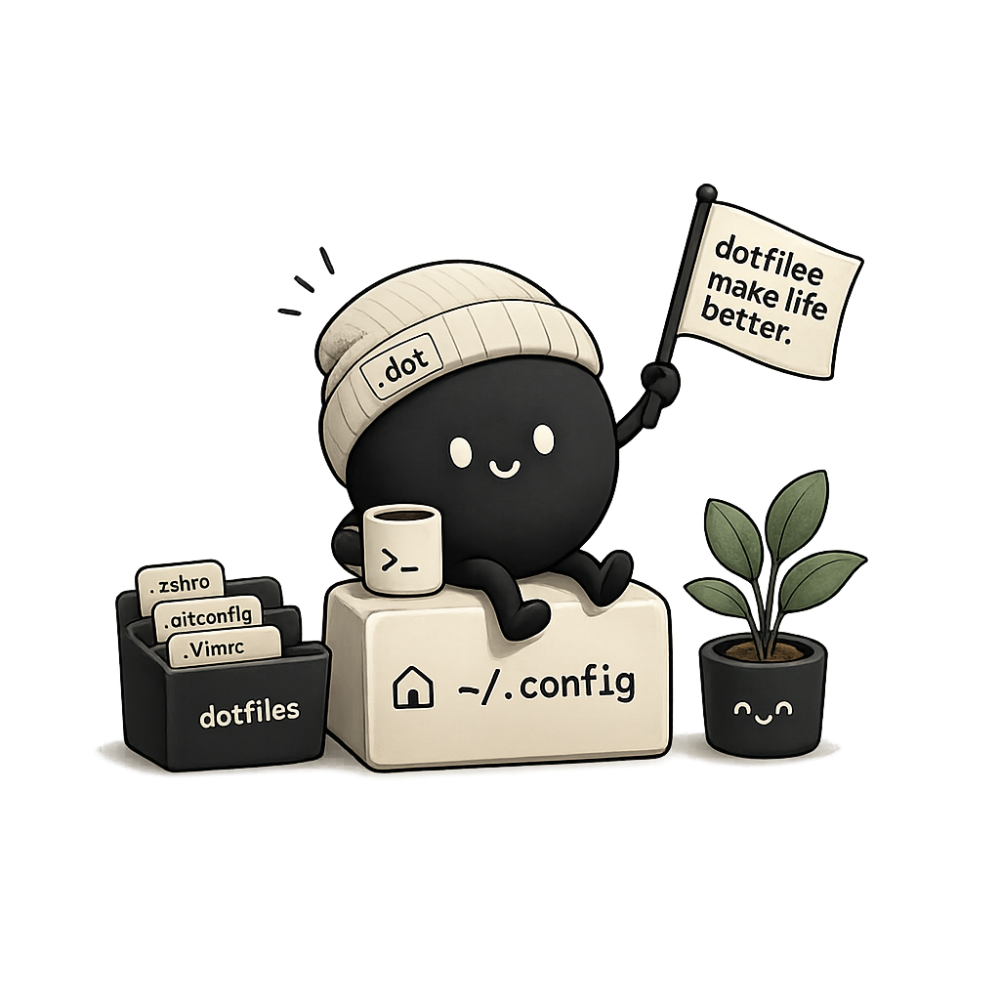
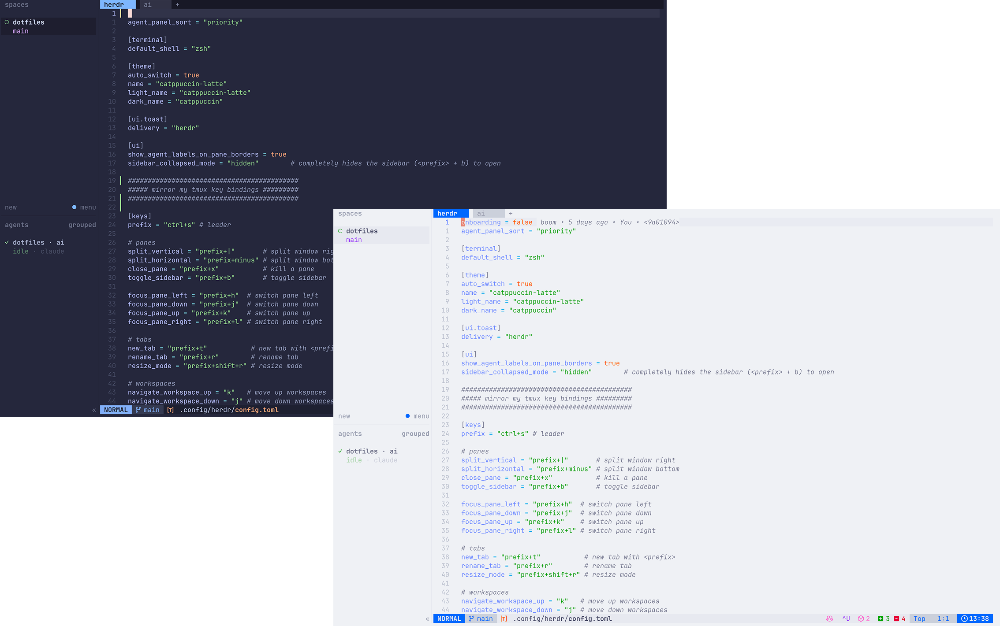

<h1 align="center">
    
    <br/>
    <sub>dotfiles</sub>
</h1>

<p align="center">
    
    
    
    
    
</p>

<p align="center">Personal configuration files — symlinked, versioned, and ready to clone.</p>

---

I live in the terminal. Everything in this repo exists to make that true without friction: one shell setup, one theme family (Catppuccin) that follows macOS between light and dark, a keyboard remapped below the OS, and every tool's config tracked in git instead of scattered across `~/.config`. It's stowed rather than copied, so editing a config here _is_ editing it live — no sync step, no drift.

If you're here for the first time, the short version:

- **Terminal:** Ghostty running zsh, with [herdr](https://herdr.dev) as the multiplexer / agent workspace (it replaced tmux).
- **Editor:** Neovim with LazyVim (`nvim/`), plus a from-scratch experiment in `nvim-lean/`.
- **Keyboard:** [kanata](https://github.com/jtroo/kanata) for home-row mods and a nav layer (it replaced Karabiner-Elements).
- **Tooling:** everything installs from one Brewfile and one `mise` config.

## Table of Contents

- [Install](#install)
- [What's in here](#whats-in-here)
- [Directory structure](#directory-structure)
- [Fresh machine setup](#fresh-machine-setup)
- [Stow reference](#stow-reference)
- [Day-to-day workflows](#day-to-day-workflows)
- [Recovering from conflicts](#recovering-from-conflicts)
- [Security](#security)
- [AI](#ai)
- [Herdr keybindings](#herdr-keybindings)

---

## Install

```bash
curl -fsSL https://raw.githubusercontent.com/mrpbennett/dotfiles/main/install.sh | bash
```

This clones the repo to `~/.dotfiles` (if it isn't already there) and runs the bootstrap described in [Fresh machine setup](#fresh-machine-setup). Read `install.sh` before piping anything to `bash` — it's short.

kanata is **not** installed by this script; see [kanata setup](#kanata-setup).

## What's in here

All app configs live under `.config/` and are symlinked into `~/.config` via GNU Stow. The repo root mirrors your home directory — stow creates the links, git tracks the content.

Machine bootstrap pieces live in `.local/share/dotfiles/` (the `Brewfile` and `macos/defaults.sh`). Shell modules shared by zsh and fish live in `.config/shell/`.

### Color Scheme



Catppuccin everywhere it's available: **Latte** for light, **Mocha** for dark. Ghostty follows macOS appearance on its own (`theme = light:Catppuccin Latte, dark:Catppuccin Mocha`), and the btop, atuin, k9s and yazi configs ship Catppuccin themes alongside them. Herdr's theme is set separately in `.config/herdr/config.toml`.

`.local/bin/catppuccinify` recolors any image to the Catppuccin Mocha palette — that's how the wallpapers in `backgrounds/` are made.

> **Why bother automating this?** Because I switch environments (bright office, dark room) more often than I remember to run a theme command. If it's not automatic, it doesn't happen.

### Shell

| Config     | What it does                                                                                 | Why I use it                                                                                       |
| ---------- | -------------------------------------------------------------------------------------------- | -------------------------------------------------------------------------------------------------- |
| `zsh`      | Primary shell (`.zshrc`) — oh-my-zsh, vi mode, and a hook that loads `~/.config/shell/all.sh` | It's the macOS default and what most completion scripts target — no reason to fight it             |
| `shell`    | Shared modules (`envs`, `init`, `functions`, `aliases`) sourced by zsh and fish              | One place for aliases and tool init instead of two diverging copies                                |
| `fish`     | Secondary shell with `conf.d` hooks for atuin and rustup                                     | Sane defaults out of the box — good for pairing sessions on someone else's box                     |
| `starship` | Cross-shell prompt showing only what's relevant: git state, language versions, exit codes    | One binary and one TOML file renders identically in zsh and fish                                   |
| `atuin`    | Replaces shell history with a searchable, syncable SQLite database                           | Ctrl+R across every terminal I've ever opened, synced across machines                              |

### Editor & Terminal

| Config      | What it does                                                                                    | Why I use it                                                                              |
| ----------- | ----------------------------------------------------------------------------------------------- | ----------------------------------------------------------------------------------------- |
| `nvim`      | [LazyVim](https://www.lazyvim.org) — a full IDE setup without the config sprawl                 | LSP, treesitter, and pickers pre-wired means I spend time editing, not configuring        |
| `nvim-lean` | An experimental minimal Neovim config built on `vim.pack` (no plugin manager)                   | Seeing how little config I actually need. Run it with `NVIM_APPNAME=nvim-lean nvim`       |
| `ghostty`   | GPU-accelerated terminal; config is one text file, including split keybinds that suit home-row mods | Replaced iTerm2's undiffable plist                                                    |
| `herdr`     | Terminal workspace manager for running several coding agents side by side, with a worktrunk plugin | Replaced tmux — one window to watch all my agents, not N tabs                          |
| `sesh`      | Session picker with zoxide integration                                                          | Still configured for tmux sessions; tmux remains installed but its config is gone         |
| `zed`       | Native editor for when I want a mouse-driven multi-file diff view                               | The occasional visual workflow. Includes LazyVim-style keybinds (see `.config/zed/docs/`) |

### TUI Tools

| Config       | What it does                                                                               | Why I use it                                                                           |
| ------------ | ------------------------------------------------------------------------------------------ | -------------------------------------------------------------------------------------- |
| `lazygit`    | Branches, rebases, and diffs in a single view                                              | I know git's plumbing but I'm not typing `git rebase -i HEAD~6` from memory every time |
| `hunk`       | Patch review and staging TUI                                                               | Reviewing hunk-by-hunk beats scrolling one giant unified diff                          |
| `worktrunk`  | Git worktree manager (`wt`), with AI-generated commit messages                             | Parallel agents each need their own worktree                                           |
| `k9s`        | Kubernetes cluster management, with plugins for argocd, cert-manager, cloudnative-pg, talos | `kubectl get` in a `watch` loop is not a debugging strategy                           |
| `sofka`      | Kubernetes TUI config (default namespace, resource aliases)                                | A second take on cluster browsing alongside k9s                                        |
| `yazi`       | Terminal file manager with previews and Catppuccin flavors                                 | Image and archive previews without shelling out to `open`                              |
| `lazydocker` | Container and image management TUI                                                         | `docker ps` piped through `less` was never a real workflow                             |
| `television` | Fuzzy finder with custom channels (git worktrees, herdr sessions, k8s contexts, AWS, …)    | Same job as fzf, but each channel is a tiny TOML file in `cable/`                      |
| `visidata`   | Terminal spreadsheet for poking at CSV/JSON                                                | Faster than loading data into a notebook                                               |

### System & Productivity

| Config                                         | What it does                                                                                    | Why I use it                                                                          |
| ---------------------------------------------- | ----------------------------------------------------------------------------------------------- | ------------------------------------------------------------------------------------- |
| `kanata`                                       | Keyboard remapping — home-row mods with quick-tap, caps as esc/ctrl, nav layer. See [`.config/kanata/docs/README.md`](.config/kanata/docs/README.md) | Home-row mods need to live below the OS keybinding layer; kanata's tap-hold beats Karabiner's |
| `aerospace`                                    | Tiling window manager config                                                                    | Keyboard-driven window layout                                                         |
| `mise`                                         | Runtime and CLI version manager — Node, Python, Go, Rust, kubectl, terraform, claude, and more  | One tool instead of nvm + pyenv + rbenv + a pile of curl-installed binaries           |
| `bat`                                          | `cat` with syntax highlighting and git gutters                                                  | Costs nothing and I run `cat` constantly                                              |
| `btop`                                         | System monitor                                                                                  | Uses the whole terminal width                                                         |
| `gh` / `gh-dash`                               | GitHub CLI and a PR/issue dashboard TUI                                                         | PRs and issues without a browser tab I'll forget to close                             |
| `sqruff`                                       | SQL linter and formatter config                                                                 | Consistent SQL formatting so PR review isn't an opinion war                           |
| [`bucky`](https://github.com/mrpbennett/bucky) | A personal S3/FTP TUI (installed via `mise`; `config.toml` is git-ignored, only an example is tracked) | Wrote it myself — nothing else gave me a fast TUI for poking at buckets         |

---

## Directory structure

```text
.
├── install.sh                 # curl-able bootstrap; excluded from stow
├── .zshrc  .gitconfig  .vimrc  .ideavimrc  .hushlogin
├── .claude/                   # CLAUDE.md, settings, statusline, skills — see AI
├── .config/                   # stowed into ~/.config, one directory per tool
│   ├── shell/                 # aliases.sh, envs.sh, init.sh, functions.sh, fns/ — sourced via all.sh
│   ├── nvim/  nvim-lean/      # LazyVim, and the minimal vim.pack experiment
│   ├── herdr/                 # only config.toml and plugins.json are tracked
│   ├── kanata/                # kanata.kbd, launchd plist, docs/
│   └── ...                    # one directory per tool in the tables above
├── .local/
│   ├── bin/catppuccinify      # recolor an image to Catppuccin Mocha (uv script)
│   └── share/dotfiles/
│       ├── Brewfile           # every formula and cask this setup depends on
│       └── macos/defaults.sh  # `defaults write` tweaks — pointer speed, key repeat, etc.
├── backgrounds/               # light/ and dark/ wallpapers
├── assets/                    # README images
└── README.md
```

Files matching `.stow-local-ignore` (`install.sh`, `README.md`, `assets/`, git metadata, untracked herdr state) are not symlinked into `$HOME`.

## Fresh machine setup

**Assumes:** macOS on Apple Silicon. The `defaults write` keys in `macos/defaults.sh` have been stable since Big Sur.

### 0. Command Line Tools

```sh
# Installs git, which the installer needs
xcode-select --install
```

### 1. Run the installer

Either use the [one-liner above](#install), or clone and run it yourself:

```sh
git clone https://github.com/mrpbennett/dotfiles.git ~/.dotfiles
~/.dotfiles/install.sh
```

The repo is expected at `~/.dotfiles` — `sync-dotfiles` and the `dotfiles` shell function both assume that path.

`install.sh` does this, in order:

1. **Installs Homebrew** if `brew` isn't on `$PATH`.
2. **Runs `brew bundle`** against `.local/share/dotfiles/Brewfile` — CLI tools (including `herdr`, `stow`, `mise`, `neovim`, `worktrunk`), plus casks for Ghostty, fonts, mitmproxy and ngrok.
3. **Stows the repo** with `--no-folding` _before_ installing oh-my-zsh — see the note below.
4. **Installs oh-my-zsh** plus the `zsh-autosuggestions` and `zsh-syntax-highlighting` plugins.
5. **Runs `mise install`** to pull every runtime and CLI pinned in `.config/mise/config.toml`.
6. **Applies macOS defaults** from `macos/defaults.sh` — pointer speed, no press-and-hold accent popup (it fights vim's key repeat), bottom-right-corner secondary click, and freeing the input-source shortcuts so `ctrl+s`-style prefixes aren't swallowed. Needs a logout or reboot to fully apply.

> **Why stow before oh-my-zsh?** A fresh machine has no `~/.zshrc`. If oh-my-zsh installs first, it writes its own template there, and stow later refuses to symlink over a real file. Stowing first means oh-my-zsh finds our `.zshrc` already in place.

> **Why `--no-folding`?** It makes stow link individual files instead of whole directories, so apps that write extra state into `~/.config/<app>/` (herdr, k9s, zed) don't dump it into the repo.

> **Verify it worked:** `readlink ~/.config/herdr/config.toml` should point into `~/.dotfiles/.config/herdr/`.

### kanata setup

kanata needs a driver and root, so it's set up by hand:

1. Install Karabiner-Elements — only for its VirtualHIDDevice driver. Its own keyboard grabbing stays disabled (the old `karabiner.json` was removed from this repo; add Karabiner's "ignore all devices" setting yourself, or kanata can't get exclusive access).
2. Install a kanata build that matches the driver version (the notes in [`.config/kanata/tasks/todo.md`](.config/kanata/tasks/todo.md) explain why brew's release isn't enough).
3. Load `.config/kanata/dev.kanata.kanata.plist` as a root launchd daemon. The plist hard-codes paths for my user and `/usr/local/bin/kanata` — edit them first.

Full keymap and timing rules: [`.config/kanata/docs/README.md`](.config/kanata/docs/README.md).

---

## Stow reference

<details>
<summary>How stow's symlinking actually works, plus the full command reference</summary>

### The mental model

This repo's root is laid out to **mirror your home directory** — `.config/herdr` in the repo corresponds to `~/.config/herdr`, `.zshrc` in the repo corresponds to `~/.zshrc`. Stow's only job is walking that tree and creating a symlink at each real-world path pointing back into the repo. Nothing is copied; editing `~/.config/herdr/config.toml` _is_ editing the file in git.

That's also why conflicts happen: if a real file already sits where a symlink needs to go, stow won't silently replace it — it errors and asks you to move it out of the way first.

### The shortcut

```sh
sync-dotfiles
```

A shell function (`.config/shell/fns/stow.sh`) that dry-runs a restow, adopts any real files that are in the way, and restows. Convenient, but it uses `--adopt`, so read [Recovering from conflicts](#recovering-from-conflicts) first.

### Dry run — preview without touching anything

```sh
# Always run this first on an unfamiliar machine
stow -nv --no-folding --target="$HOME" .
```

### Stow — create symlinks

```sh
stow --no-folding --target="$HOME" .
```

Idempotent. Already-correct symlinks are left alone.

### Restow — sync after changes

```sh
# After adding a new tool config, renaming a directory, or pulling changes
stow --restow --no-folding --target="$HOME" .
```

### Unstow — remove all symlinks

```sh
stow --delete --target="$HOME" .
```

</details>

---

## Day-to-day workflows

### Editing a config

Just edit it. `nvim ~/.config/herdr/config.toml` is editing the repo. Type `dotfiles` in zsh to open the whole repo in Neovim.

### Adding a new app's config

Move the existing config into the repo, then restow:

```sh
mv ~/.config/newapp ~/.dotfiles/.config/newapp
sync-dotfiles   # or: cd ~/.dotfiles && stow --restow --no-folding --target="$HOME" .
```

Then commit the new directory. The symlink is live immediately. If the app writes state or secrets into its config directory, add them to `.gitignore` (see the herdr and hunk entries for examples).

### Adding a package

Add a `brew "name"` or `cask "name"` line to `.local/share/dotfiles/Brewfile`, or a tool to `.config/mise/config.toml`. Then `brew bundle --file=~/.dotfiles/.local/share/dotfiles/Brewfile` or `mise install`.

### Removing an app

```sh
rm -rf ~/.dotfiles/.config/oldapp
stow --restow --no-folding --target="$HOME" .   # cleans up the dead symlinks
```

---

## Recovering from conflicts

If stow exits with a `conflicts` error, a real file (not a symlink) exists at the target path. Two options:

```sh
# Option 1: back it up and re-run
mv ~/.config/problem-app ~/.config/problem-app.bak
stow --no-folding --target="$HOME" .
```

```sh
# Option 2: adopt it — stow moves the file INTO the repo and links back
stow --adopt --no-folding --target="$HOME" .
git diff  # always review before committing
```

> **Note on `--adopt`:** This rewrites the file _in your repo_ to match what's on disk. If the on-disk version is worse than what you had committed, you'll overwrite your config. Check `git diff` before you `git add` anything, and `git checkout -- <file>` to undo.

---

## Security

**Never commit credentials to this repo.**

API keys, tokens, and passwords belong in a machine-local file that's sourced but never tracked. `.config/shell/all.sh` already sources `~/pulsepoint.sh` if it exists (work-only scripts live there), and the same pattern works for secrets:

```sh
# ~/.env.local — outside the repo, sourced from your shell
export GITHUB_TOKEN="ghp_..."
```

- Machine-specific secrets live outside this repo's tracked files, or are listed in `.gitignore` (not `.stow-local-ignore`, which only controls what stow skips, not what git tracks). Examples already ignored: `.config/bucky/config.toml`, `.config/gh/hosts.yml`.
- Long-term secrets belong in a password manager or secrets manager, not in any dotfile.
- If you accidentally commit a secret, treat it as compromised immediately — git history is public.

> **Before every commit:** run `git diff --staged` and actually read it. A one-line "just adding a new alias" commit is exactly where a pasted token hides.

---

## AI

A [`.claude/CLAUDE.md`](.claude/CLAUDE.md) file lives in this repo and tells [Claude Code](https://claude.ai/code) how to behave. It encodes the same caution I'd want from a human collaborator touching my personal environment:

- **Read-only GitHub access** — no PRs, commits, or pushes on my behalf.
- **Extend, don't replace** — when editing an existing config or keybinding, preserve what's there instead of regenerating it.
- **Plan before touching config** — non-trivial changes get a written plan first, since a botched `stow --adopt` can quietly eat a config I care about.
- **Verify before claiming done** — check the change actually works rather than assuming a plausible diff behaves.

`.claude/` also holds `settings.json` and `statusline.sh`, and the [`skills/`](.claude/skills/) directory gives the agent focused workflows:

- **`changelog`** turns commits since the last release into a Keep a Changelog-formatted update.
- **`context7-mcp`** fetches current library documentation before answering framework or API questions.
- **`til`** records a Today I Learned note in a separate TIL repository.

The same ideas apply to herdr: it's how I run several agents in parallel, each in its own `worktrunk` worktree.

---

## Herdr keybindings

<details>
<summary>Custom keybindings — prefix is <code>Ctrl+s</code>. Source of truth: <code>.config/herdr/config.toml</code></summary>

Reload with `prefix + q` (or the `hrc` alias); `prefix + ?` shows help.

### Panes

| Key                                     | Action                       |
| --------------------------------------- | ---------------------------- |
| `prefix + \|` / `prefix + v` / `Alt + Enter`       | Split vertically   |
| `prefix + -` / `prefix + h` / `Alt + Shift + Enter` | Split horizontally |
| `Alt + Esc`                             | Close pane                   |
| `Ctrl + Alt + h/j/k/l` (or arrows)      | Focus pane left/down/up/right |
| `prefix + Shift + o`                    | Rename pane                  |
| `prefix + b`                            | Toggle sidebar               |
| `prefix + [`                            | Copy mode                    |

### Tabs (tmux "windows")

| Key                                | Action        |
| ---------------------------------- | ------------- |
| `prefix + c`                       | New tab       |
| `prefix + r`                       | Rename tab    |
| `prefix + x`                       | Close tab     |
| `prefix + 1..9` / `Alt + 1..9`     | Switch to tab |
| `prefix + p` / `prefix + n`        | Previous / next tab |

### Workspaces (tmux "sessions")

| Key                                  | Action                  |
| ------------------------------------ | ----------------------- |
| `prefix + Shift + c`                 | New workspace           |
| `prefix + Shift + r`                 | Rename workspace        |
| `prefix + Shift + k`                 | Close workspace         |
| `prefix + Shift + p/n` / `Alt + ↑/↓` | Previous / next workspace |
| `prefix + d`                         | Detach                  |

### Popups and plugins

| Key                  | Action                                                     |
| -------------------- | ---------------------------------------------------------- |
| `prefix + f`         | Scratch terminal                                           |
| `prefix + Alt + g`   | lazygit                                                    |
| `prefix + Alt + h`   | hunk diff                                                  |
| `prefix + Alt + k`   | k9s                                                        |
| `prefix + Alt + d`   | gh dash                                                    |
| `prefix + Alt + b`   | btop                                                       |
| `prefix + Shift + g` | Worktrunk: switch / create a worktree from the default branch |
| `prefix + Shift + d` | Worktrunk: remove a worktree                               |

</details>
